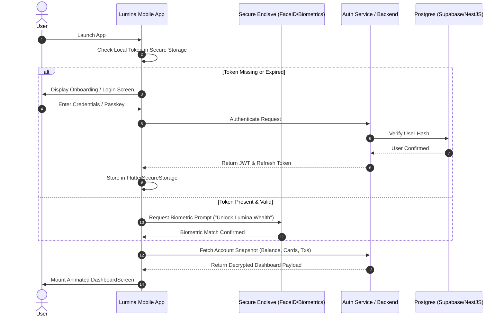
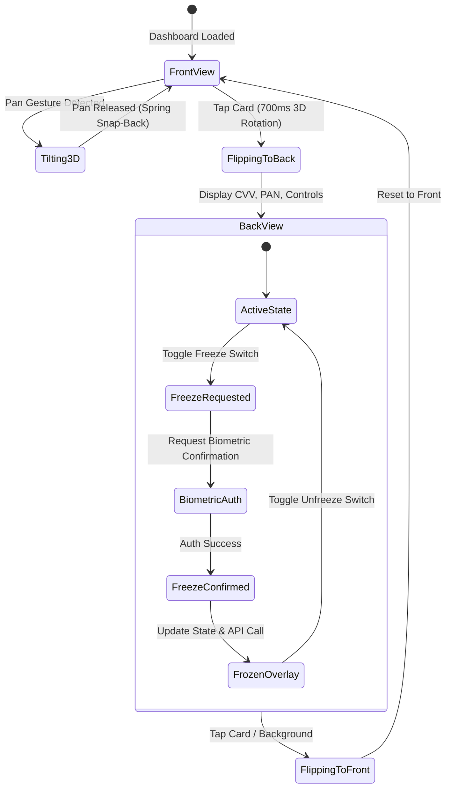
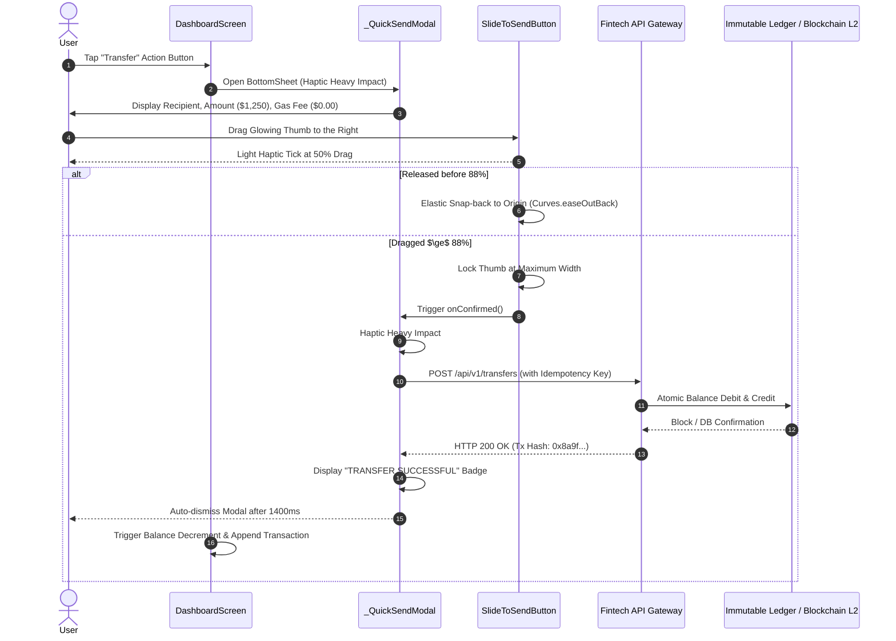

# User Journey & Workflow Audit: Lumina Wealth (`lumina_fintech`)

This document audits the critical user journeys, maps system interactions, and specifies failure recovery workflows.

---

## 1. Journey 1: First Launch & Authentication Flow

### Current vs. Target Reality
* **Current State:** The app directly launches into `DashboardScreen` with a hardcoded user identity (`Roshan Chachre`) and zero authentication barrier.
* **Target State:** Production-grade security requires a biometric vault with passkey / local auth and backend session verification.

---

## 2. Journey 2: 3D Card Interaction & Card Freeze Workflow

The virtual/physical card acts as a high-security hardware proxy.

### Detailed Interaction Breakdown:
1. **Initiation:** User drags finger across the card.
2. **Physics & Transform:** `_InteractiveCardState._onPanUpdate` computes normalized delta offsets:
   $$\theta_x = \text{clamp}(\theta_x + \Delta y \times 0.0012, -0.35, +0.35)$$
   $$\theta_y = \text{clamp}(\theta_y - \Delta x \times 0.0012, -0.35, +0.35)$$
3. **Card Sheen:** A moving diagonal gradient (`LuminaColors.glassSheen`) translates across the titanium surface proportionally to $\theta_x, \theta_y$.
4. **Flipping:** On single tap, `_flipController.forward()` executes a $180^\circ$ Y-axis rotation using `Curves.easeInOutBack`.
5. **Freeze Action:** When the user flips to the back and hits "Freeze Card", a local state change currently disables the card. In production, this must invoke an atomic API call: `PATCH /api/v1/cards/{id}/status`.

---

## 3. Journey 3: Slide-to-Confirm Instant Wire Transfer

This journey is the primary financial movement within Lumina Wealth.

### Edge Cases & Failure Scenarios:
1. **Network Drop During Slide Completion:**
   * *Problem:* User drags past 88%, slider locks, but network request fails.
   * *Current Behavior:* Unchecked `Future.delayed` closes the modal regardless, showing fake success.
   * *Required Behavior:* Display retry dialog with exponential backoff; never show "TRANSFER SUCCESSFUL" without verified 200 OK response from API.
2. **Duplicate Submissions:**
   * *Protection:* The slider thumb locks immediately upon hitting 88%, preventing double-drag. A client-generated UUID v4 idempotency key must accompany the API request to prevent duplicate debiting on network retries.

---

## 4. Journey 4: Touch-Scrubbing Historical Wealth Spline

1. **Initiation:** User places finger on `GlowChart`.
2. **Gesture Capture:** `_onPanUpdate(details, width)` clamps the touch position:
   $$x_{scrub} = \text{clamp}(\text{localPosition.dx}, 0, W)$$
3. **Coordinate Mapping:** The widget calculates the closest historical data slice:
   $$\text{index} = \text{round}\left( \frac{x_{scrub}}{W} \times (N - 1) \right)$$
4. **Drawing Output:**
   * Vertical cyan laser line drawn with `Color(0x8000E5FF)`.
   * Glow cursor drawn with solid white center and neon cyan halo.
   * Dynamic valuation tooltip displays current price at that exact hour/day.
5. **Release:** On `onPanEnd`, the scrub line smoothly fades out over 300ms.
