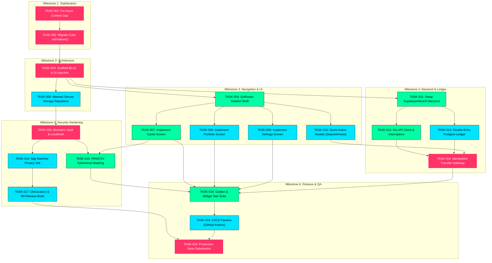

# Dependency Map & Execution Graph: Lumina Wealth (`lumina_fintech`)

This document visualizes the hard prerequisites, parallel execution tracks, and external dependencies governing the implementation of Lumina Wealth.

---

## 1. Task Dependency & Critical Path Graph

---

## 2. Critical Path Analysis
The **Critical Path** (the longest sequence of dependent activities that determines project duration) is:
$$\text{TASK-001} \rightarrow \text{TASK-002} \rightarrow \text{TASK-003} \rightarrow \text{TASK-011} \rightarrow \text{TASK-012} \rightarrow \text{TASK-014} \rightarrow \text{TASK-018} \rightarrow \text{TASK-020}$$

* **Minimum Duration to Production:** 26 business days with 1 full-time senior developer.
* **Bottleneck Risk:** Backend deployment and database schema finalization (TASK-011) directly gates live ledger syncing and transfer execution.

---

## 3. External Dependencies & Blockers Table

| Dependency Name | Type | Purpose | Risk if Delayed | Mitigation Plan |
|---|---|---|---|---|
| **Apple Developer Account** | Institutional | iOS Signing, TestFlight, FaceID entitlement | Cannot distribute to iPhone users | Enroll immediately under corporate entity |
| **Google Play Console** | Institutional | Android production release | Delays Android rollout | Create developer account and complete 14-day tester requirements |
| **Supabase / PostgreSQL Server** | Infrastructure | Real-time database, Auth, RLS | Blocks Milestone 4 | Develop locally first using Docker PostgreSQL container |
| **Payment / Ramp Gateway** | External Partner | Processing real fiat wire transfers (Stripe/Plaid) | Live money transfer remains in sandbox | Use mock sandbox API credentials during development |
| **Hardware Devices** | Physical Testing | Testing 3D tilt gyro, biometric FaceID, haptics | Visual bugs on real OLED/Retina screens | Test on user's local iPhone and Android physical devices |
