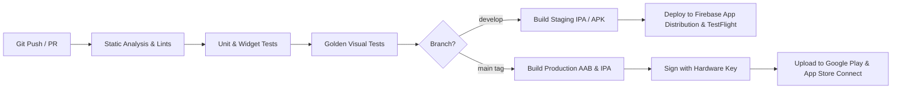

# Deployment, CI/CD & Operations Plan: Lumina Wealth (`lumina_fintech`)

This document defines the deployment pipeline, release automation, infrastructure environments, and operational incident response for Lumina Wealth.

---

## 1. Multi-Environment Architecture

| Environment | Purpose | Mobile Flavor | Backend Base URL | Database |
|---|---|---|---|---|
| **Development** | Local engineering & emulation | `dev` | `http://10.0.2.2:3000` (Android) / `http://localhost:3000` (iOS) | Local Docker Postgres |
| **Staging** | QA testing & Internal TestFlight | `staging` | `https://staging-api.luminawealth.com` | Managed Staging DB |
| **Production** | Live institutional banking | `prod` | `https://api.luminawealth.com` | High-Availability Cluster with Read Replicas |

---

## 2. Secrets & Configuration Management

* **No Plaintext Secrets in Source Code:** All API keys, RPC endpoints, and Stripe credentials must be injected at build time using `--dart-define-from-file=config/{flavor}.json`.
* **Sample Configuration Structure (`config/prod.json`):**
  ```json
  {
    "API_BASE_URL": "https://api.luminawealth.com/v1",
    "ENABLE_BIOMETRICS": true,
    "SENTRY_DSN": "https://...@sentry.io/...",
    "ARBITRUM_RPC_URL": "https://arb1.arbitrum.io/rpc"
  }
  ```
* **Git Safeguard:** `config/*.json` is added to `.gitignore`. An example template `config/example.json` is provided for developer onboarding.

---

## 3. Automated CI/CD Pipeline (GitHub Actions)



### GitHub Actions Workflow Specification (`.github/workflows/build.yml`):
1. **Trigger:** Pull request to `main` or tagged release (`v*.*.*`).
2. **Steps:**
   * Setup Flutter environment (Flutter 3.x, Java 17).
   * Run `flutter pub get`.
   * Run `flutter analyze` (Zero issues required).
   * Run `flutter test --coverage`.
   * Compile release binaries with code obfuscation:
     * **Android:** `flutter build appbundle --release --obfuscate --split-debug-info=./symbols`
     * **iOS:** `flutter build ipa --release --obfuscate --split-debug-info=./symbols`

---

## 4. Production Monitoring & Telemetry

* **Crash Reporting:** Sentry Flutter SDK (`sentry_flutter`) captures unhandled exceptions with obfuscated stack trace de-symbolication.
* **Performance Monitoring:** Tracing frame drops and jank during 3D card tilt and spline rendering.
* **Alerting:** PagerDuty alerts triggered if transfer failure rate exceeds 1% in any 5-minute window.

---

## 5. Rollback Procedures
* **Backend Rollback:** Blue/Green deployment with instant DNS switch back to previous container image.
* **Mobile Rollback:** 
  * If critical bug escapes to app stores, toggle feature flags via Remote Config (e.g. disabling the transfer slider and showing "Service Under Maintenance").
  * Submit emergency hotfix release with expedited Apple App Review request.
